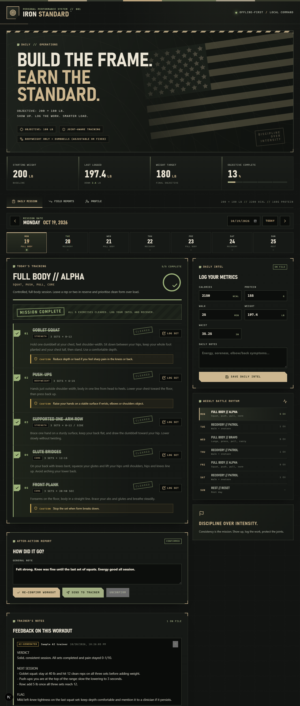
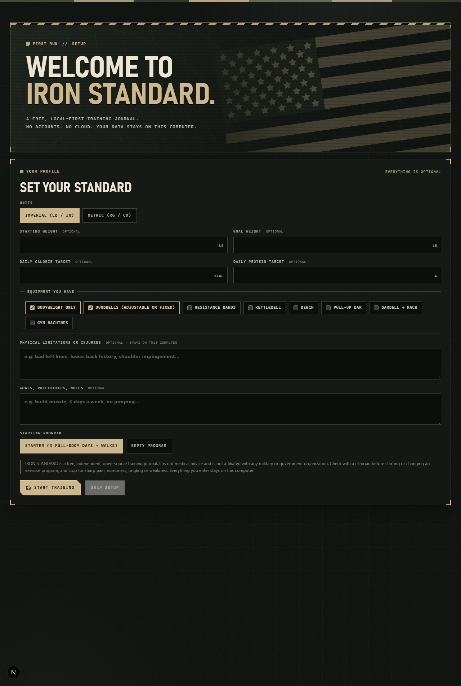
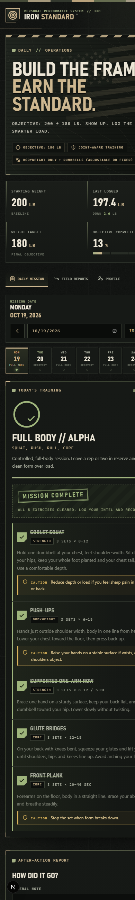

# IRON STANDARD

A free, open-source, **local-first** fitness tracker with a tactical matte-black / FDE / olive look.
No accounts. No cloud. No telemetry. Your workouts, measurements and notes live in a SQLite database on your own computer.

> **Status: v0.1.0 pre-release.** Core tracking works. A Windows installer, a program editor, data export/import and optional AI-trainer integrations are on the roadmap. Expect rough edges.



<p>
  
  
</p>

*Screenshots use sample data.*

## Features

- Weekly workout schedule with a daily checklist and exercise instructions
- Per-set logging: weight, reps, 0–10 pain score and a note for every set
- Daily metrics: weight, waist, calories, protein, walking minutes, notes
- Optional AI trainer with a guided setup for a free, private local model (Ollama): paste a reply, use your local Claude CLI, or bring your own API key (Anthropic, OpenAI-compatible, or local Ollama). Never automatic, always confirmed, never changes your history
- Every exercise explains what it works and why it helps
- Suggested weight for every exercise, based on your history and pain scores (conservative: never progresses on unrecorded or reported pain), with optional trainer picks
- Exercise illustrations: original start/finish stick figures with the working muscles highlighted (24 common movements; free to use, drawn for this project)
- Your data, your files: full JSON export, spreadsheet (CSV) export of your sets, import (merge or replace) with automatic safety backups, one-click SQLite backups with download and restore, and an in-app view of exactly where your files live
- Program editor: build your own week, edit sessions and exercises, or add from a built-in exercise library filtered to your equipment
- First-run setup: imperial or metric, optional goals and targets, equipment, physical limitations, starter or empty program (everything optional, skippable)
- After-action report and an optional **Send to trainer** export: a self-contained text report you can paste into any AI assistant (or read yourself), and a place to save the reply as clearly labelled, append-only feedback
- Works fully offline; nothing leaves your machine unless you copy it out yourself

## Quick start

You need [Node.js](https://nodejs.org) 20 or newer (22 recommended; choose the "LTS" download). Then, in a terminal (PowerShell on Windows, Terminal on macOS/Linux):

```bash
git clone https://github.com/AllThingsBear/iron-standard.git
cd iron-standard
npm install
npm run build
npm start
```

Open **http://localhost:4871** in your browser. The first screen walks you through setup.

To keep using it, run `npm start` again from the same folder. For development with live reload use `npm run dev` instead of build/start.

> Windows note: if `npm install` complains about building `better-sqlite3`, install the "Desktop development with C++" workload from Visual Studio Build Tools, or use Docker below. Most machines download a prebuilt binary and need nothing extra.

IRON STANDARD uses port **4871** (an uncommon port, to avoid clashing with other local apps). To use another one: `npm start -- -p 5000`.

Your data is stored in `./data/iron-standard.db` (override with the `DB_PATH` environment variable).

## Run it with Docker

```bash
docker compose up --build -d
```

Open http://localhost:4871. The container is published on `127.0.0.1` only (change the host port on the left of `4871:3000` in `docker-compose.yml` if it clashes), and data persists in the `iron_standard_data` volume.

- Update: `git pull && docker compose up --build -d` (your volume is kept)
- Stop: `docker compose down` (do **not** add `-v` unless you intend to delete your data)
- Back up: `docker run --rm -v iron_standard_data:/data -v "${PWD}:/backup" busybox tar czf /backup/iron-standard-backup.tgz -C /data .`
- Restore: stop the app, then `docker run --rm -v iron_standard_data:/data -v "${PWD}:/backup" busybox tar xzf /backup/iron-standard-backup.tgz -C /data`

> The native install and the Docker install use different databases.

## Documentation

- [User guide](docs/USER_GUIDE.md): daily use, logging, trainer reports
- [AI trainer setup](docs/AI_SETUP.md): paste, Claude CLI, API key, or a free private local model with Ollama
- [Troubleshooting](docs/TROUBLESHOOTING.md)
- [Contributing](CONTRIBUTING.md) · [Security policy](SECURITY.md) · [Changelog](CHANGELOG.md)

## Your data

Open the **DATA** tab in the app to see where everything is stored, download an export, create or restore a backup, and import data from another computer. Everything is in one SQLite file (`data/iron-standard.db`); backups go to `data/backups/`. Trainer reports are saved as Markdown in `data/reports/`. The `data/` folder is git-ignored, so `git pull` never touches it.

## Roadmap

- [x] Local profile and goals (no hardcoded personal data)
- [x] Per-set logging, pain tracking, session notes, trainer report export
- [x] Trainer feedback saved back onto each workout
- [x] Program editor and exercise library (schedule, sessions, exercises)
- [x] Data export / import and in-app backup
- [ ] Windows installer (Electron)
- [x] Optional AI integrations (local Claude CLI, bring-your-own API key)

## Disclaimer

IRON STANDARD is a self-managed training journal. It is **not medical advice** and does not diagnose, treat or prevent anything. Talk to a qualified clinician before starting or changing an exercise or nutrition program, and stop for sharp pain, numbness, tingling or weakness. Calorie and protein figures are whatever you enter. Any AI-generated feedback is not a substitute for a professional.

IRON STANDARD is an independent project. It is **not affiliated with or endorsed by any military, veterans' or government organization**. The flag artwork is original, simple vector art drawn for this project.

## Privacy and security

No analytics, advertising or tracking. The server binds to localhost by default and has **no authentication**, so do not expose it to a network without adding your own protection (reverse proxy with auth and TLS). See [SECURITY.md](SECURITY.md).

## License

MIT. See [LICENSE](LICENSE).
